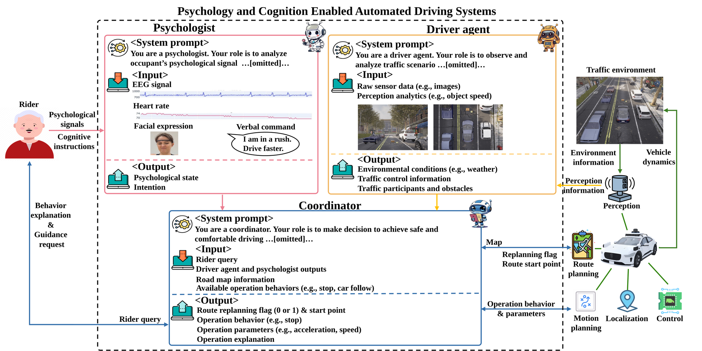
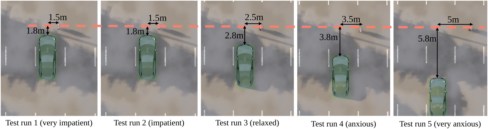

<div align="center">

# PACE-ADS

### Your ride, your rules: Psychology and cognition enabled automated driving systems

**Zhipeng Bao, Qianwen Li**<br>
University of Georgia

*Journal of Intelligent and Connected Vehicles (JICV), 2026*

[](https://doi.org/10.26599/JICV.2026.9210099)
[](https://arxiv.org/abs/2506.11842)


[](LICENSE)



</div>

## Overview

PACE-ADS (Psychology and Cognition Enabled Automated Driving Systems) lets an automated vehicle respond to
both the traffic around it and the state of its occupant. Three foundation-model agents work together:

* **Driver agent**: interprets the traffic scene from the front camera and the perception measurements.
* **Psychologist agent**: infers the occupant state from passive psychological signals (EEG, heart rate,
  facial expression) and interprets verbal commands.
* **Coordinator**: combines both reports, selects a driving behavior and its parameters within a safety
  envelope, and explains the decision.

PACE-ADS works at the behavioral planning layer. Real-time planning and control stay with the host AV
stack (here, the CARLA behavior agent), which executes the selected behavior with the selected parameters.

## What this repository contains

This repository contains the code used to run the closed-loop CARLA simulations of the
**personalization tests** in Section 3.3 of the paper: a ROS 2 implementation of the three agents,
the scenario configurations, the behavior library, the run scripts, and a script that prepares the
occupant-signal samples from the Emognition dataset.

| Test in the paper | `scenario` value |
|---|---|
| Traffic signal interaction (Section 3.3.1) | `traffic_light` |
| Pedestrian interaction (Section 3.3.2) | `pedestrian` |
| Work zone navigation (Section 3.3.3) | `work_zone` |
| Car following (Section 3.3.4) | `car_following` |

<p align="center">
  
  <br>
  <em>Pedestrian interaction (Section 3.3.2): the stopping distance to the pedestrian and the lateral clearance at restart grow from very impatient (left) to very anxious (right).</em>
</p>

## Quick start

```bash
git clone https://github.com/hzxbzp/PACE-ADS.git
cd PACE-ADS
/usr/bin/python3 -m pip install -r requirements.txt
# install ROS 2 Humble, CARLA 0.9.15 and carla-ros-bridge first (Section 3)
cd pace_ads_ws
source /opt/ros/humble/setup.bash && source ~/carla-ros-bridge/install/setup.bash
colcon build && cd ..

# start the CARLA 0.9.15 server, then:
export OPENAI_API_KEY="<your key>"
export ROS_BRIDGE_WS=~/carla-ros-bridge
./run_scenario.sh traffic_light ~/occupant_samples   # traffic_light | pedestrian | work_zone | car_following
```

See the detailed guide below for installation (Section 3), occupant data (Section 4) and running a test (Section 5).

## Citation

```bibtex
@article{bao2026paceads,
  title   = {Your ride, your rules: Psychology and cognition enabled automated driving systems},
  author  = {Bao, Zhipeng and Li, Qianwen},
  journal = {Journal of Intelligent and Connected Vehicles},
  year    = {2026},
  doi     = {10.26599/JICV.2026.9210099}
}
```

---

# Detailed guide

## Contents

```
PACE-ADS/
├── README.md                          this file
├── requirements.txt                   Python packages
├── run_scenario.sh                    starts all nodes of one test (one xterm window per node)
├── tools/
│   └── prepare_emognition_sample.py   builds the occupant signal samples from the Emognition dataset
└── pace_ads_ws/                       ROS 2 workspace
    └── src/car_following/             ROS 2 package (ament_python)
        ├── launch/carla_ros_bridge.launch.py   CARLA bridge, ego vehicle with sensors, rviz2
        ├── config/objects_<scenario>.json      ego vehicle and sensors (start position of each test)
        ├── config/carla_ad_demo_ros2.rviz      rviz2 layout
        ├── car_following/
        │   ├── scenario_node.py               builds the test scenario
        │   ├── psychological_monitor_node.py  psychologist agent: occupant signals -> occupant report
        │   ├── decision_node.py               driver agent and coordinator
        │   ├── control_node.py                host AV stack: executes the behavior with the decided parameters
        │   ├── record_node.py                 trajectory logging
        │   ├── multi_agents.py                prompts, model and output schemas of the three agents
        │   ├── agents_threads_runs.py         calls of the agents (OpenAI Responses API)
        │   ├── behavior_library.py            behavior library and permitted parameter ranges
        │   ├── scenario_config.py             scenario settings, default parameters, message layout
        │   ├── occupant_state.py              occupant states
        │   ├── occupant_signals.py            reading of the occupant signal samples
        │   └── lat_controller.py              lateral PID controller of the surrounding vehicles
        └── carla_navigation/                  route planning, motion planning and control (based on the CARLA agents)
```

## 1. How the simulation works

```
CARLA 0.9.15 server (Town06)
   ^
   |  carla_ros_bridge: synchronous mode, 0.05 s steps; spawns the ego vehicle (Tesla Model 3,
   |  role name "hero") with its sensors
   |
   +-- scenario_node               traffic lights, pedestrian, work zone, surrounding vehicles
   +-- psychological_monitor_node  psychologist agent: EEG, heart rate, face image, verbal command
   |                               -> occupant report R = {state, instruction}
   +-- decision_node               driver agent: front camera image + measurements -> scene understanding Y
   |                               coordinator: Y + R + behavior library -> behavior, parameters, explanation N
   +-- control_node                host AV stack (CARLA BehaviorAgent): route planning, motion planning
   |                               (IDM, gap acceptance, stopping) and PID control with the parameters of N
   +-- record_node                 trajectories of all vehicles and pedestrians
```

* The **driver agent** runs continuously. Each inference uses the latest front-camera image and the
  measurements of the perception module (simulator ground truth: ego speed, nearby vehicles and
  pedestrians with their lane, distance and speed, the traffic light of the ego lane, work-zone elements).
* The **psychologist agent** is invoked when the signals of an occupant state are injected
  (Section 5.4). It reports the inferred state (very impatient, impatient, relaxed, anxious or very
  anxious) and the occupant's instruction, if any.
* The **coordinator** is invoked for every occupant report. It selects the behavior and the value of
  every behavior parameter from the behavior library of the scenario (Section 7) and explains the
  decision. The parameters are clamped to their permitted ranges (safety envelope) and sent to the
  control node, which executes the behavior in real time.

ROS 2 topics:

| Topic | Type | Publisher -> subscriber |
|---|---|---|
| `/carla/hero/rgb_front/image` | sensor_msgs/Image | carla_ros_bridge -> decision_node |
| `/occupant_report` | std_msgs/String (JSON) | psychological_monitor_node -> decision_node |
| `/psychological_output` | std_msgs/Int32 | manual state input (1 relaxed, 2 anxious, 3 impatient, 4 very anxious, 5 very impatient) -> decision_node |
| `/algorithm_params_topic` | std_msgs/Float32MultiArray | decision_node (or manual input) -> control_node |
| `/traffic_light_control` | std_msgs/String | operator (`red`, `yellow`, `green`) -> scenario_node |
| `/ped_control` | std_msgs/String | operator (`go`) -> scenario_node |
| `/scenario_ready` | std_msgs/String | scenario_node -> run_scenario.sh |
| `/carla/hero/speedometer` | std_msgs/Float32 | carla_ros_bridge -> record_node |

## 2. Requirements

| Component | Version |
|---|---|
| Operating system | Ubuntu 22.04 LTS |
| ROS 2 | Humble Hawksbill |
| Simulator | CARLA 0.9.15 and AdditionalMaps 0.9.15 (contains Town06) |
| CARLA-ROS bridge | carla-ros-bridge, ROS 2 version (https://github.com/carla-simulator/ros-bridge), built from source |
| Python | 3.10 (the interpreter of ROS 2 Humble) with the packages of `requirements.txt`: carla 0.9.15, openai >= 1.66, numpy 1.24.4, shapely 2.0.6, networkx 3.2.1, opencv-python 4.10, transforms3d 0.4.2 |
| Foundation models | OpenAI `gpt-4o-2024-08-06` for all three agents, OpenAI Responses API (an API key is required; the calls are billed by OpenAI) |
| Occupant data | Emognition Wearable Dataset 2020 (Section 4) |

Hardware: the simulations of the paper were run on a workstation with an AMD Ryzen Threadripper
7960X (24 cores) and two NVIDIA RTX 5000 Ada GPUs. CARLA needs a GPU with at least 6 GB of memory
(8 GB recommended) and about 20 GB of disk space.

## 3. Installation

### 3.1 CARLA 0.9.15

Download `CARLA_0.9.15.tar.gz` and `AdditionalMaps_0.9.15.tar.gz` from
https://github.com/carla-simulator/carla/releases/tag/0.9.15, then

```bash
mkdir -p ~/CARLA_0.9.15
tar -xzf CARLA_0.9.15.tar.gz -C ~/CARLA_0.9.15
mv AdditionalMaps_0.9.15.tar.gz ~/CARLA_0.9.15/Import/
cd ~/CARLA_0.9.15 && ./ImportAssets.sh        # installs Town06
```

### 3.2 ROS 2 Humble and tools

Install ROS 2 Humble Desktop (https://docs.ros.org/en/humble/Installation.html), then

```bash
sudo apt install python3-colcon-common-extensions python3-rosdep python3-pip ros-humble-cv-bridge xterm
```

### 3.3 Python packages

```bash
cd PACE-ADS
/usr/bin/python3 -m pip install -r requirements.txt
```

The nodes are started by ROS 2 with `/usr/bin/python3`, so the packages must be installed for this
interpreter.

### 3.4 carla-ros-bridge

```bash
mkdir -p ~/carla-ros-bridge && cd ~/carla-ros-bridge
git clone --recurse-submodules https://github.com/carla-simulator/ros-bridge.git src/ros-bridge
# The bridge only accepts the CARLA Python module version written in this file (0.9.13 by default).
echo "0.9.15" > src/ros-bridge/carla_ros_bridge/src/carla_ros_bridge/CARLA_VERSION
source /opt/ros/humble/setup.bash
sudo rosdep init        # only once per computer
rosdep update
rosdep install --from-paths src --ignore-src -r -y
colcon build
```

### 3.5 This package

```bash
cd PACE-ADS/pace_ads_ws
source /opt/ros/humble/setup.bash
source ~/carla-ros-bridge/install/setup.bash
colcon build
```

### 3.6 OpenAI API key

The key is read from the environment variable `OPENAI_API_KEY`; it is not stored in the package.
Export it in every terminal that runs `decision_node` or `psychological_monitor_node`:

```bash
export OPENAI_API_KEY="<your key>"
```

## 4. Occupant signal samples (Emognition dataset)

The psychologist agent receives the occupant's passive psychological signals: EEG band powers,
heart rate and a facial image. In the paper they are taken from the Emognition Wearable Dataset
2020 (Saganowski et al., 2022, *Scientific Data* 9, 158; https://doi.org/10.7910/DVN/R9WAF4), in
which 43 participants watched emotion-eliciting film clips while wearing a Muse 2 EEG headband and
a Samsung Galaxy Watch and were filmed. The dataset is **not** redistributed with this package:
request it from its authors and unpack `study_data.zip` and the upper-body videos.

`tools/prepare_emognition_sample.py` builds one sample per occupant state. It cuts a time window of
the film (stimulus) phase of one participant and clip, averages the EEG band powers at AF7/AF8
(Alpha, Beta, Theta) in 0.25 s bins and the heart rate in 1 s bins, saves one frame of the video
as the face image and records the participant's self-report for the clip:

```bash
S=/path/to/study_data          # unpacked study_data.zip
V=/path/to/videos              # upper-body videos of the dataset
OUT=~/occupant_samples
python3 tools/prepare_emognition_sample.py --study-data $S --participant 22 --clip NEUTRAL \
    --state relaxed --start 30 --duration 20 --video $V/<video of participant 22, NEUTRAL>.mp4 --out-dir $OUT
python3 tools/prepare_emognition_sample.py --study-data $S --participant 22 --clip ANGER \
    --state "very impatient" --start 30 --duration 20 --video $V/<video of participant 22, ANGER>.mp4 --out-dir $OUT
# ... one call for each of the five states
```

Options: `--start` and `--duration` (window in s from the start of the clip, default 0 and 20),
`--eeg-interval` and `--hr-interval` (bin lengths, default 0.25 s and 1 s), `--video-time` (time
of the video frame, default: middle of the window) or `--face-image` (use an existing image).
The state definitions follow Section 3.2 of the paper: anger is remapped to impatience, and the
'very' levels correspond to a self-reported intensity of at least 4 on the 1-5 scale. The dataset
contains the clips AMUSEMENT, ANGER, AWE, DISGUST, ENTHUSIASM, FEAR, LIKING, NEUTRAL, SADNESS and
SURPRISE and the BASELINE recording; for example, use ANGER for the impatient states, FEAR for the
anxious states and NEUTRAL or BASELINE for the relaxed state, all from the same participant. The
tool prints the participant's self-report for the clip and warns if it does not match the
intensity level of the chosen state.

Result (the folder names are the states with underscores):

```
~/occupant_samples/
├── very_impatient/  eeg.csv  hr.csv  face.jpg  meta.json
├── impatient/       ...
├── relaxed/
├── anxious/
└── very_anxious/
```

The samples contain data of the dataset's participants; use them only under the dataset's terms.
Without samples, `psychological_monitor_node` can run in direct mode (Section 5.4).

## 5. Running a test

### 5.1 Start the CARLA server

```bash
cd ~/CARLA_0.9.15 && ./CarlaUE4.sh           # add -RenderOffScreen on a computer without display
```

### 5.2 Start all nodes with one command

```bash
cd PACE-ADS
export OPENAI_API_KEY="<your key>"
export ROS_BRIDGE_WS=~/carla-ros-bridge       # workspace of carla-ros-bridge
./run_scenario.sh traffic_light ~/occupant_samples
```

The script opens one xterm window each for carla_ros_bridge, scenario_node, decision_node,
psychological_monitor_node, record_node and control_node, waits until the ego vehicle and the
scenario are ready, and prints the output folder (`~/pace_ads_output/<scenario>_<date>_<time>`).
The ego vehicle starts driving when control_node starts. Without the second argument, the
psychologist agent is bypassed (direct mode).

### 5.3 Start the nodes step by step

In every terminal:

```bash
source /opt/ros/humble/setup.bash
source ~/carla-ros-bridge/install/setup.bash
source PACE-ADS/pace_ads_ws/install/setup.bash
S=traffic_light                       # traffic_light | pedestrian | work_zone | car_following
OUT=~/pace_ads_output/run_1
```

| Terminal | Command |
|---|---|
| 1 | `ros2 launch car_following carla_ros_bridge.launch.py scenario:=$S` (add `rviz:=False` without display); wait until the ego vehicle has been spawned |
| 2 | `ros2 run car_following scenario_node --ros-args -p scenario:=$S`; wait for `Scenario '...' is ready` |
| 3 | `export OPENAI_API_KEY="<your key>"`, then `ros2 run car_following decision_node --ros-args -p scenario:=$S -p output_dir:=$OUT` |
| 4 | `export OPENAI_API_KEY="<your key>"`, then `ros2 run car_following psychological_monitor_node --ros-args -p samples_dir:=$HOME/occupant_samples -p output_dir:=$OUT` |
| 5 | `ros2 run car_following record_node --ros-args -p scenario:=$S -p output_dir:=$OUT` |
| 6 | `ros2 run car_following control_node --ros-args -p scenario:=$S` (the ego vehicle starts) |

### 5.4 During a run

**Occupant state.** Type a state in the terminal of `psychological_monitor_node` to inject the
signals of that state: `very impatient`, `impatient`, `relaxed`, `anxious` or `very anxious`
(`comfortable`, `nervous` and `very nervous` are accepted as aliases). A verbal command can be
added after `|`, for example `impatient | Please drive a bit faster.` The psychologist agent
reports the state it infers from the signals, and the coordinator adapts the behavior. A prescribed
occupant-state sequence is produced by typing the states at the chosen moments, e.g. `very impatient`
at the start and `relaxed` after the vehicle has accelerated. Until the first report, the ego
vehicle drives with the default parameters of the scenario (Section 7).

In direct mode (no `samples_dir`), the typed state is published as it is. A state can also be
published without the monitor node:
`ros2 topic pub --once /psychological_output std_msgs/msg/Int32 "data: 3"` (codes in Section 1).

**Scenario events.**

* `traffic_light`: all traffic lights are red at the start. When the ego vehicle has stopped at the
  stop line, switch them to green:
  `ros2 topic pub --once /traffic_light_control std_msgs/msg/String "data: 'green'"`
* `pedestrian`: when the ego vehicle has stopped in front of the pedestrian, start the crossing:
  `ros2 topic pub --once /ped_control std_msgs/msg/String "data: 'go'"`
* `work_zone`, `car_following`: no operator action.

**End of a run.** Stop all nodes with Ctrl+C (scenario_node removes the actors it spawned). Restart
carla_ros_bridge for the next run; it reloads Town06.

## 6. Scenario details

Common settings: CARLA Town06; synchronous simulation with 0.05 s steps; ego vehicle Tesla Model 3
with front RGB camera (1024 x 768, 75 deg field of view), bird's-eye-view camera, GNSS, IMU, radar,
depth and semantic cameras and speedometer; route destination: spawn point 183; speed limit
60 km/h. The ego vehicle and the surrounding vehicles drive in the -x direction.

| Scenario | Ego start (CARLA x, y) | Scenario actors | Operator action |
|---|---|---|---|
| `traffic_light` | (413.85, -16.96) | all traffic lights red and frozen at the start | switch the lights to green after the stop |
| `pedestrian` | (498.85, -16.96) | pedestrian (walker.pedestrian.0001) at the roadside next to spawn point 48 (7 m offset); crosses 15 m at 3 m/s | start the crossing after the stop |
| `work_zone` | (495.70, -20.96) | work zone (traffic cones, street barriers and two construction signs) around spawn point 297 closing the ego lane; four vehicles in the adjacent left lane, placed from spawn point 433 with gaps of -15.5, 5, 15 and 25 m, driving at 40 km/h (the first cruises, the others follow with the IDM) | none |
| `car_following` | (498.85, -16.96) | lead vehicle (Audi A2) 15.5 m ahead (center to center) with the speed profile 40 km/h for 40 s, 60 km/h for 30 s, then 30 km/h | none |

Other initial conditions can be simulated by editing the ego spawn point in
`config/objects_<scenario>.json` (the file uses ROS coordinates: y and yaw have the opposite sign
of the CARLA coordinates above; rebuild the package after editing) or, for the surrounding
vehicles, with the scenario_node parameter `traffic_gaps`, e.g.
`--ros-args -p scenario:=work_zone -p traffic_gaps:="[-12.5, 7.0, 15.0]"`.

## 7. Behavior library and parameters

The behavior library documents to the coordinator what the host AV stack can execute
(`behavior_library.py`); the defaults are the benchmark configuration of each scenario
(`scenario_config.py`). The coordinator sets every parameter within the permitted range
(values outside are clamped).

| Scenario | Behaviors |
|---|---|
| `traffic_light` | stop and go at traffic light |
| `pedestrian` | yield to pedestrian |
| `work_zone` | work zone lane change |
| `car_following` | car following; lane change left |

| Parameter | Meaning | `traffic_light` | `pedestrian` | `work_zone` | `car_following` |
|---|---|---|---|---|---|
| `max_speed` (km/h) | target cruise speed | 40 [15, 60] | 40 [15, 40] | 40 [15, 40] | 40 [30, 60] |
| `tf` (s) | reaction time to the red light: braking starts at (speed x tf) | 4 [1, 8] | - | - | - |
| `ped` (s) | reaction time to the pedestrian: braking starts at (speed x ped) | - | 3.5 [1, 8] | - | - |
| `wz` (s) | reaction time to the work zone | - | - | 4 [2, 10] | - |
| `angle_th` (deg) | half angle of the pedestrian detection cone (restart when the pedestrian leaves it) | - | 25 [15, 45] | - | - |
| `safety_distance` (m) | minimum front and rear gap for accepting the lane change | - | - | 5 [1, 25] | - |
| `T` (s) | IDM desired time headway | 2.5 [0.5, 5] | 2.5 [0.5, 5] | 1.5 [0.5, 5] | 1.5 [0.5, 5] |
| `a` (m/s^2) | IDM maximum acceleration | 0.55 [0.1, 3] | 0.35 [0.1, 3] | 0.75 [0.1, 3] | 0.75 [0.1, 3] |
| `b` (m/s^2) | IDM comfortable deceleration | 1.67 [1, 4] | 1.67 [1, 4] | 1.67 [1, 4] | 1.67 [1, 4] |
| `s_0` (m) | IDM minimum gap; stopping distance to the pedestrian is about s_0 + 0.8 m | 3 [1, 8] | 2 [1, 8] | 4 [2, 8] | 3 [1.5, 8] |

Values are given as default [permitted range].

**Message to the control node.** `/algorithm_params_topic` carries the parameter values in the
following order (NaN, or a missing trailing value, keeps the current value):

| Scenario | `data` layout |
|---|---|
| `traffic_light` | `[max_speed, tf, T, a, b, s_0]` |
| `pedestrian` | `[max_speed, ped, T, a, b, s_0, angle_th]` |
| `work_zone` | `[max_speed, wz, T, a, b, s_0, safety_distance]` |
| `car_following` | `[max_speed, T, a, b, s_0, lc_flag, cruise_flag]` (lc_flag 1 = change to the left lane; cruise_flag 1 = cruise at max_speed without following the lead vehicle) |

Parameters can also be set manually, e.g. only the cruise speed in the traffic light scenario:

```bash
ros2 topic pub --once /algorithm_params_topic std_msgs/msg/Float32MultiArray "data: [50.0, .nan, .nan, .nan, .nan, .nan]"
```

## 8. Output files

* `record_node` writes one CSV file per actor type to `output_dir` (default
  `~/pace_ads_output/<scenario>_<date>_<time>`), one row per simulation step:
  `vehicle_tesla_model3.csv` (ego vehicle), the files of the surrounding vehicles (e.g.
  `vehicle_audi_a2.csv`) and `walker_pedestrian_0001.csv`. Columns: `sim_time` (s), `type_id`,
  `role_name`, `x`, `y` (m, CARLA coordinates), `vx`, `vy` (m/s), `speed_kmh`.
* `decision_node` (with `output_dir`) appends every driver-agent and coordinator call to
  `agent_log.jsonl`: simulation and wall-clock time, latency, measurements, agent outputs, the
  published parameters and clamping notes.
* `psychological_monitor_node` (with `output_dir`) appends every occupant report, the psychologist
  agent's reasoning and the source of the injected sample to `psychologist_log.jsonl`.

## 9. License

See [LICENSE](LICENSE).


The PACE-ADS code is released under the Apache License 2.0, as declared in `setup.py` and
`package.xml`. The modules in `carla_navigation/` and `car_following/lat_controller.py` are derived
from the CARLA PythonAPI agents (Copyright (c) 2018-2020 CVC, MIT License) and keep their license
headers.

